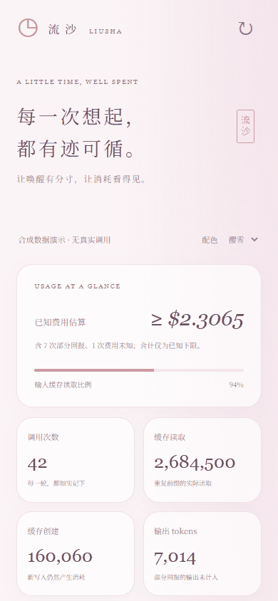

# 流沙 · Liusha Wakeup Kit

**让自动唤醒有分寸，让每一次模型调用有账可查。**

从一个持续使用的 AI 陪伴前端中提取：自主唤醒、白天空闲冒泡、静默缓存保活、逐次用量统计、输入缓存命中分析，以及随皮肤变化的「流沙」界面。代码与设计由项目所有者授权公开，个人数据与凭据未包含在内。



## 你会得到什么

| 内容 | 位置 | 状态 |
| --- | --- | --- |
| 现有生产方案提取：原生会话、静默保活、自动冒泡 | `integrations/production/` | 来自运行方案；路径、凭据与身份已参数化，接入需要已有 bridge |
| 流沙原有 HTML / JS / CSS 提取 | `integrations/frontend/` | 保留 DOM ID 与接口契约，适合迁移到现有前端 |
| 独立美化版流沙界面 | `web/` | 无外部字体、图片或构建依赖；青提、樱雪、雾蓝三套皮肤 |
| 可直接运行的只读演示、统计与策略模块 | `liusha/` | 仅标准库，不要求模型账号 |
| systemd、环境变量、反向代理与协议样例 | `deploy/`、`examples/` | 示例模板，默认不会安装或启用自动任务 |
| 中文原理、成本边界、接入方式与排错 | `docs/` | 从机制到逐字段说明 |

这里公开的是**唤醒、保活、可观测性模块**，不是原站的完整后端、聊天内容、私人系统提示词或品牌素材。原生 Claude Code 调度能力、订阅额度与上游协议会变化；生产适配器要先在自己的版本上检查能力，再启用。

## 一分钟看效果

需要 Python 3.11+。演示不发起任何模型请求，也不需要 API Key。

```bash
git clone https://github.com/a3426534804-cloud/liusha-wakeup-kit.git
cd liusha-wakeup-kit
python -m liusha.server --demo
```

打开 <http://127.0.0.1:8779>，切换时间、来源、皮肤，展开每轮调用的明细。演示的费用和调用全部为**合成样例**。

```bash
# 测试不会调用真实模型，也不会修改线上状态
python -m unittest discover -s tests -v
python scripts/audit_release.py
```

读取自己的 usage 文件：

```bash
python -m liusha.server --usage-log /path/to/token_usage.jsonl \
  --runtime-state /path/to/silent-cache-keepalive.json
```

服务默认只监听回环地址。需要远程访问时设置 `LIUSHA_DASHBOARD_TOKEN`，通过自己的 HTTPS 反向代理访问；不要把真实账本放进公开静态站点。

## 先理解这四件事

1. **自主唤醒**：同一个常驻模型会话中的原生调度轮次；不同于 Python 定时发送一句话。
2. **自动冒泡**：操作系统定时器每分钟做一次便宜的本地判断；只有满足条件才发送真实消息。
3. **静默保活**：不显示消息、不保存探测对话，但仍然发起可计量的模型请求。过期、配置变化或意外重建时停下。
4. **流沙账本**：只读实际 usage；页面刷新不会唤醒模型。缓存创建、读取、未缓存输入和输出分别记录。

## 方案中的默认规则

下面是本次提取时核对的部署规则，不是 Claude 平台的通用保证：

| 机制 | 核心条件 | 停止 / 跳过 |
| --- | --- | --- |
| 自主唤醒 | 已验证会话；由运行时 `ScheduleWakeup` 安排下一次 | 用户关闭；01:00–09:00 静默；运行时能力缺失；用户消息优先 |
| 白天冒泡 | 用户先开启当天聊天；最近消息和模型调用均达到 50 分钟；调用仍在 55 分钟以内 | 夜间、正在聊天、会话变化、缺少 usage、窗口已过期 |
| 静默保活 | 同一会话、同一前缀配置；距离有效锚点达到 35 分钟 | 达到 50 分钟；共享锁忙；零缓存读取；创建 ≥10,000 tokens；无法取得 usage |
| 流沙 | 读取逐次 JSONL，先筛日期和来源再分页 | 不生成消息、不调用模型、不暴露正文或令牌 |

时区默认 `Asia/Shanghai`。白天窗口实际是 **09:00 到次日 01:00**，并非历史版本的 09:00–21:00。早安文案存在于旧脚本兼容列表中，不代表当前脚本每天 09:00 一定发送早安。

## 文档导航

- [整体架构与数据流](docs/architecture.md)
- [自主唤醒、自动脚本和静默时间](docs/wakeups.md)
- [静默缓存保活的完整原理与边界](docs/keepalive.md)
- [逐次用量、命中率、费用和压缩事件](docs/usage-and-cache.md)
- [接入已有前端 / bridge 的接口契约](docs/integration.md)
- [部署、停用与排错](docs/operations.md)
- [流沙设计、美化与适配](docs/design.md)
- [发布隐私边界与安全说明](SECURITY.md)
- [本次开源验证结果](docs/validation.md)
- [源码提取和改动范围](docs/provenance.json)

## 成本与兼容性

这是一套“防止无意义冷重建、看清实际消耗”的方法，不保证降低任何订阅套餐的计费额度，也不绕过平台限制。缓存命中有成本；输出不显示不等于没有生成；中断后的 usage 可能不完整。

`ScheduleWakeup`、stream control、CLI result usage 语义以及 `--no-session-persistence` 要在你的实际 Claude Code 版本验证。生产适配器保留了失败后暂停、只继承真实聊天 model/effort、用户消息优先等行为。默认不附带真实会话、私有 MCP 服务或压缩系统；具体接法见 [integration](docs/integration.md)。

## 许可证与贡献

MIT。欢迎修复兼容性、补测试、贡献新的数据源和皮肤。提交问题请只附脱敏 usage 字段及软件版本，**不要上传聊天正文、OAuth 文件、系统提示词、数据库或密钥**。参见 [CONTRIBUTING](CONTRIBUTING.md)。
