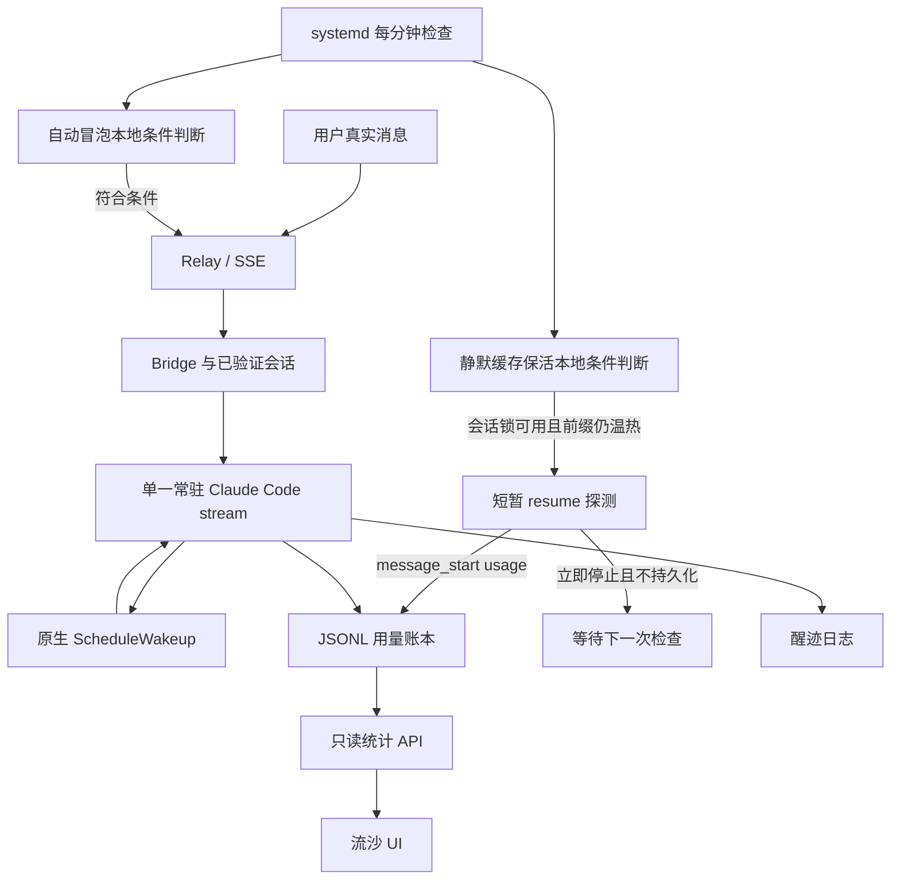

# 整体架构：谁负责触发，谁负责记账

## 三条数据线

**消息线**：用户、可见冒泡与需要发送的唤醒答复走 relay；普通回复的 SSE delta、思考摘要与最终答复继续使用已有 bridge。

**控制线**：自主唤醒开关写入偏好文件。原生运行时每隔几秒检查，不需要为“关闭开关”再调用一次模型。关闭原生唤醒不自动停用另两个 systemd 定时器；界面必须分别显示它们。

**可观测线**：真实调用完成时写 usage；静默探测从 `message_start` 读取 usage，标记部分回报。统计接口只读取这些文件。**用量页不是调度入口。**

## 文件协议

| 文件 | 谁写 | 内容与边界 |
| --- | --- | --- |
| `state/claude_session.json` | 现有 bridge | 已建立的会话 ID 与状态；不对外公开 |
| `state/auto-wakeup-preference.json` | 鉴权控制 API | 用户希望启用 / 停用；不等于调度器已就绪 |
| `state/awakening.json` | 原生运行时 | 当前状态、下一次唤醒时间 |
| `state/silent-cache-keepalive.json` | 静默保活脚本 | 决策、读取量、创建量、下次到期、熔断 |
| `logs/token_usage.jsonl` | 所有实际调用者 | 一条调用一行；应避免正文与凭据 |
| `logs/awakening.jsonl` | 原生运行时 | 醒来后所想、所说、是否已发送；包含私密内容，绝不能随账本公开 |

状态文件采用同目录临时文件 + `os.replace`，权限 0600。完整运行方案只使用一个跨进程会话锁，普通聊天、静默探测、切换会话和压缩都必须遵循同一个锁契约。

## 为什么不在浏览器里定时

手机锁屏、PWA 退到后台、网络切换都会让页面定时器被暂停。真正的调度和日志保留在服务端；前端只展示状态和发送明确控制请求。开不开流沙页面，不应影响唤醒计划。

## 开源提取与独立演示的关系

`integrations/production/` 是现有方案的定向提取。`liusha/` 是为了方便理解和验证而新增的独立只读统计、纯策略函数与演示服务器。两者没有被假装成一键安装的整站系统：前者需要适配已有 bridge，后者在无模型账号时即可运行。
