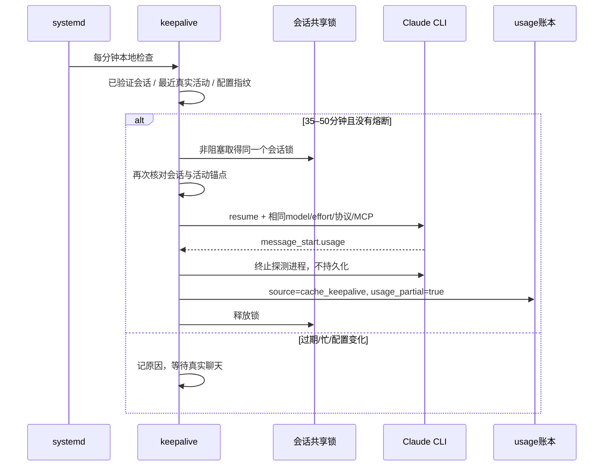

# 静默缓存保活：从条件判断到 usage

## “静默”到底指什么

指不往聊天 relay 发可见消息、不持久化探测对话，也不主动冷启动一段已过期的完整上下文。**它仍然向模型服务发送请求，可能产生缓存读取、写入、未缓存输入和少量生成费用。**

## 时序

## 锚点与配置指纹

`activity_key = session_id + 最近有效真实调用时间 + 命令/协议/MCP内容指纹`。

同一 activity_key 下使用最近成功刷新作为新的时间锚点；探测失败则设置 disabled，后续检查不会每分钟重复付费试错。真实聊天产生新的活动锚点后，才允许重评估。

配置改动也可能破坏前缀一致性。提取版核对 MCP、唤醒偏好、环境文件的修改时间；并把实际命令、协议与 MCP 文本纳入 hash。单纯修改 Python 源码的 mtime 不足以证明模型前缀变化。

## 为什么选择 35 / 50 分钟

这组参数来自按一小时缓存窗口设计的运行方案，给系统定时器漂移和请求延迟留出余量。**不能照搬到只有 5 分钟 TTL 的服务**。使用者必须先核对自己的上游缓存策略和实际 usage；没有证据时应保持定时器停用。

原生运行时仍在持有会话锁时，保活跳过。这避免了“常驻进程 + 旁路 resume”同时修改一个会话。如果桥接器只用了一个 Python 线程锁，旁路进程看不见，不能声称有跨进程互斥。

## 探测与止损

探测使用 `--resume`、相同提示前缀和 MCP，配合 `--no-session-persistence`。监听到 `message_start` 的 usage 后立即终止。没有 usage、`cache_read_input_tokens <= 0` 或 `cache_creation_input_tokens >= 10000`，都暂停等待真实聊天。

10,000 是本方案的**保守止损阈值**，不是上游定义的冷缓存判据。长的新附件、压缩后新前缀等正常行为也会产生大量创建。暂停后应读日志排查，不应自动增加阈值反复重试。

## 为什么费用只是下限

进程停止时未必有最终 result。已经发生的网络请求和推理不会因为客户端 kill 而被撤销。`usage_partial=true`，output 未完整回报，cost 是已知输入的下限估算；若输入细分类别或价格未知，就保持 null，不能把缺失费用写成 0。

生产提取版保留了原部署对 `claude-opus-4-6` 的历史输入估算公式，作为来源证据。它不是当前价格表，也不能移植到其他模型直接使用。新接入请按自己供应商更新公式，或者不显示估算。

## 验证是否值得启用

对照同一会话中的真实调用和静默探测，至少记录：前后时间、model、effort、前缀配置指纹、读取 tokens、创建 tokens、已知费用、下一条真实消息是否仍读取缓存。把所有额外探测开销一起算进去。

一次探测成功只能说明那次读到了缓存；不能证明之后一直命中，更不能证明整个套餐额度被节省。原生提示缓存的准确匹配与 TTL 以[官方缓存文档](https://platform.claude.com/docs/en/build-with-claude/prompt-caching)为准。
